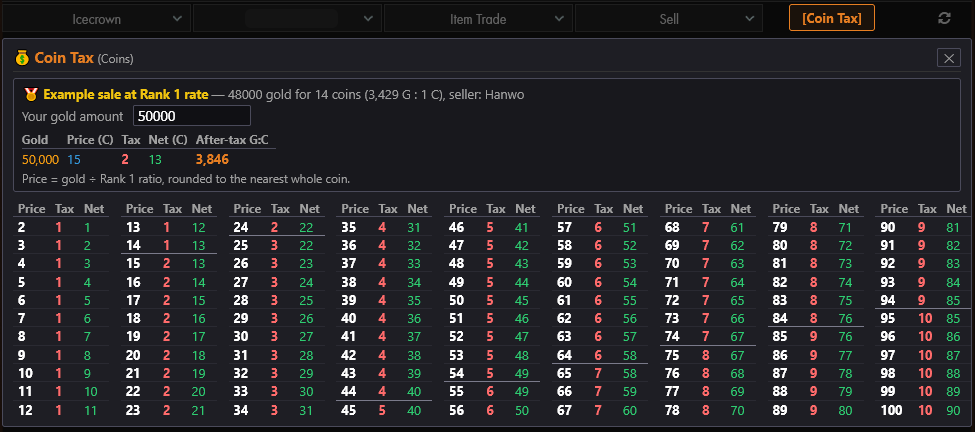

# WarmaneGoldCoinRatio
A tampermonkey script to show the best deals for gold on the Warmane trade site, and to work out the coin tax when selling.

## Features

The script adds one button to the trade page toolbar. Which button you see depends on the trade mode you have selected.

### Buy mode: Top 9 Gold Deals
- Click **[Top 9 Gold Deals]** to rank the visible listings by gold per coin.
- Identical offers are grouped together, and each card shows the sellers, the gold amount, the coin cost and the G : C ratio.
- Make sure the **Gold** tab is selected before clicking, otherwise the results won't be accurate.

### Sell mode: Coin Tax
Click **[Coin Tax]** to open the coin tax window.

- **Per-price tax table:** every selling price from 2 to 100 coins is listed individually with the tax and the net coins you receive, instead of broad ranges. A brighter divider marks the price where the tax steps up.
- **Example sale at the Rank 1 rate:** enter your own gold amount (for example `50000`, `50,000`, `50k` or `1.5m`) and the window shows the price in coins, the tax, the net coins and the after-tax G : C ratio, based on the Rank 1 deal from the Top 9 list.
  - The price is your gold divided by the Rank 1 ratio, rounded to the nearest whole coin.
  - The Rank 1 data comes from the last time you clicked **[Top 9 Gold Deals]**. Run it in Buy mode first, then switch to Sell mode and open Coin Tax. If there is no data yet, the window tells you so. The data is kept until you reload the page.

### How the tax is calculated
The tax is 1 coin at minimum, otherwise the price divided by 10 and rounded to the nearest whole coin:

| Price (coins) | Tax |
|---------------|-----|
| 1 - 14 | 1 |
| 15 - 24 | 2 |
| 25 - 34 | 3 |
| 35 - 44 | 4 |
| 45 - 54 | 5 |

The pattern continues in steps of 10. Prices above 54 follow the same pattern but have not been checked against Warmane, so verify them before relying on them.

## Installation
1. Install a userscript manager such as [Tampermonkey](https://www.tampermonkey.net/).
2. Create a new script and paste in the contents of `Gold-Coins-Ratio_TampermonkeyScript.txt`.
3. Open the Warmane trade page (`https://www.warmane.com/account/trade`).

If you have an older version installed, paste the new version over it rather than adding it as a second script, otherwise you will get two buttons.

## Configuration
Near the top of the coin tax function in the script you can adjust:
- `MIN_PRICE` and `MAX_PRICE`: the range of prices shown in the table (default 2 to 100).
- `COLUMNS`: how many columns the table is split into (default 9). Use fewer columns for a narrower, taller window.

## Version
Current version: 2.3